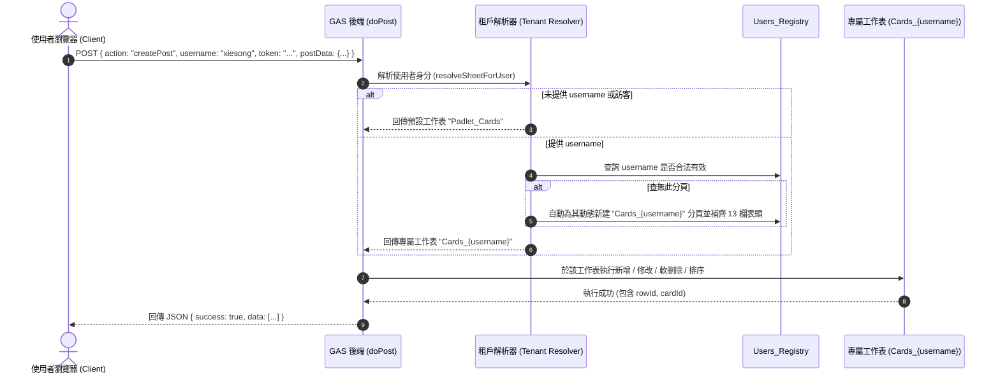
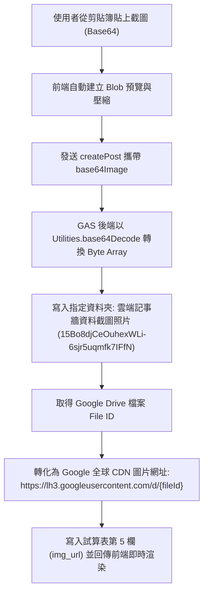
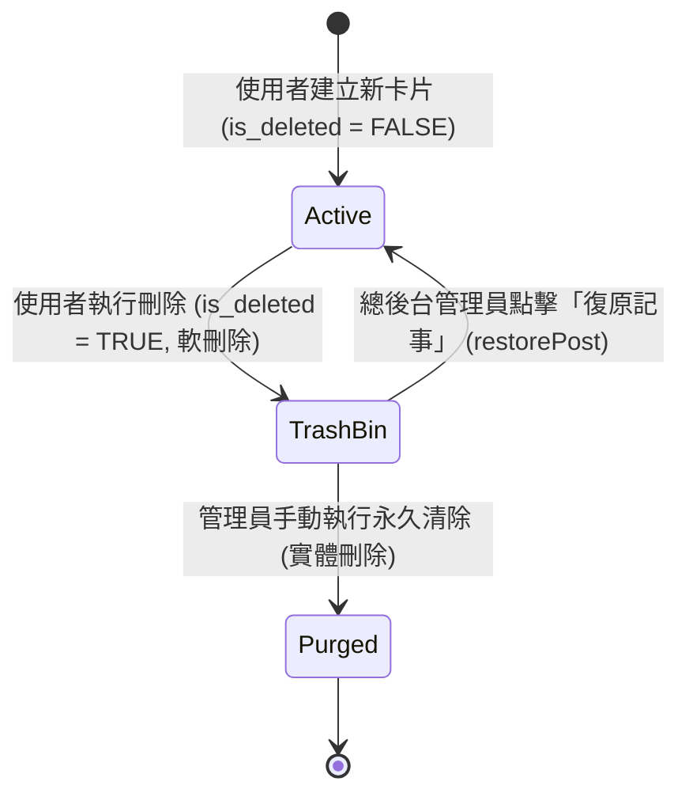

# 系統架構藍圖規格書 (Architecture Blueprint)

> **專案代號**：Padlet-Style Cloud Wall App (雲端記事牆 APP)  
> **版本**：v2.1.0  
> **核心設計思維**：無伺服器 (Serverless)、多租戶隔離 (Multi-tenant Sheet Tab Isolation)、零成本、安全防護與即時可復原。

---

## 1. 系統整體拓撲圖 (System Topology)

本專案採用 100% 免費雲端原生服務（Zero-Cost Cloud Native）組合構建，分為前端呈現層、無伺服器計算層、關聯結構化資料層與多媒體物件存儲層：

```mermaid
graph TD
    subgraph ClientLayer["客戶端 (Client Browser / Mobile / PWA)"]
        UI["前端網頁 UI (HTML5 / CSS3 / ES6 Vanilla JS)"]
        LocalStorage["本機暫存 (Session, Local Cache, Auth Token)"]
        PWA["Service Worker (離線快取 & PWA 清單)"]
    end

    subgraph Hosting["靜態託管層 (100% Free)"]
        GHPages["GitHub Pages<br/>(https://cs22study.github.io/clipboard-app/)"]
        GHRepo["GitHub Repository<br/>(cs22study/clipboard-app)"]
    end

    subgraph ServerlessCompute["計算與邏輯層 (Google Apps Script)"]
        GAS["GAS Web App (doPost / doGet)<br/>(Deployment Versioned via Clasp)"]
        AuthModule["認證與多租戶分派模組<br/>(Tenant Sheet Resolver)"]
        ActionRouter["API Action 路由處理器 (13+ Actions)"]
        SecurityValidator["資安防護與 PIN 比對器"]
    end

    subgraph StorageLayer["雲端資料與物件存儲層 (Google Workspace Free Tier)"]
        subgraph DriveStorage["Google 雲端硬碟"]
            MainFolder["主專案目錄: 線上筆記資料速記APP<br/>(ID: 14LNISHVvM8h5oaVx4bKbTgnNcRqeQcmW)"]
            PhotoFolder["截圖子目錄: 雲端記事牆資料截圖照片<br/>(ID: 15Bo8djCeOuhexWLi-6sjr5uqmfk7IFfN)"]
        end
        subgraph SheetDB["Google 試算表資料庫 (ID: 1n33bBAwBLvEuikyr0wRgWww8wsK5yYW33hcLYj7-STM)"]
            UserReg["工作表: Users_Registry (使用者註冊與權限表)"]
            AdminCfg["工作表: Admin_Settings (全域參數與管理密碼)"]
            PublicTab["工作表: Padlet_Cards (公開記事資料)"]
            UserTab1["工作表: Cards_user_xiesong (專屬隔離工作表)"]
            UserTabN["工作表: Cards_{username} (動態擴充使用者工作表)"]
        end
    end

    GHPages -->|載入資源| UI
    UI <-->|POST JSON (CORS/text-plain)| GAS
    GAS --> AuthModule
    AuthModule --> ActionRouter
    ActionRouter --> SecurityValidator
    SecurityValidator -->|寫入/讀取/軟刪除| SheetDB
    ActionRouter -->|上傳圖片 Base64| PhotoFolder
    GHRepo -->|Git CI/CD| GHPages
```

---

## 2. 多租戶分頁隔離模型 (Multi-tenant Sheet Tab Isolation Model)

為了滿足多個使用者各自登入帳號、擁有完全獨立的記事看板且互不干擾，同時保持單一 Google 試算表便於統一管理與備份，系統採用 **Tab-based Tenant Isolation (分頁級租戶隔離機制)**。

### 2.1 租戶結構模型

```
┌─────────────────────────────────────────────────────────────────────────────┐
│ Google 試算表：雲端記事牆APP_Padlet資料庫 (ID: 1n33bBAwBLvEuikyr0wRgWww8wsK5yYW33hcLYj7-STM) │
├───────────────────────────────┬─────────────────────────────────────────────┤
│ 1. Users_Registry (系統控制表) │ 紀錄所有註冊帳號、顯示名稱、密碼雜湊、角色與分頁名稱   │
├───────────────────────────────┼─────────────────────────────────────────────┤
│ 2. Admin_Settings (系統參數表)│ 存放 master_pin (預設 8888)、全域配置參數     │
├───────────────────────────────┼─────────────────────────────────────────────┤
│ 3. Padlet_Cards (公開共用表)   │ 訪客或未登入狀態預設讀寫之公開看板              │
├───────────────────────────────┼─────────────────────────────────────────────┤
│ 4. Cards_{username} (獨立租戶) │ 使用者註冊時自動建立，欄位完全對齊 13 欄，隔離度 100% │
└───────────────────────────────┴─────────────────────────────────────────────┘
```

### 2.2 動態租戶解析流程 (Tenant Sheet Resolver)



---

## 3. 端對端資料流架構 (Data Flow Architecture)

### 3.1 跨域無預檢請求傳輸 (CORS Optimization)

瀏覽器對跨網域 POST JSON 預設會觸發 `OPTIONS` 預檢請求，而 GAS Web App 處理 `OPTIONS` 容易發生 302 重導向失敗。  
因此前端採用 `fetch(GAS_URL, { method: 'POST', body: JSON.stringify(payload), headers: { 'Content-Type': 'text/plain;charset=utf-8' } })` 技術，以 Simple Request 形式直達後端，規避 CORS 預檢延遲與錯誤。

### 3.2 圖片儲存與 CDN 加速流程



---

## 4. 資安防護體系 (Security Defense Architecture)

本專案奉行 **零資安風險 (Zero-Vulnerability)** 原則，部署多層防禦：

1. **嚴防 XSS (Cross-Site Scripting)**：
   - 前端所有動態產生的卡片標題、內文、標籤、主題名稱，在組合進 innerHTML 前一律通過全域安全過濾函數 `escapeHtml()`。
   - 包含 `<`、`>`、`&`、`"`、`'` 均被轉換為對應之 HTML 實體字元，避免惡意 script 注入。
2. **敏感密碼不落地與伺服器端核對 (Server-Side PIN Validation)**：
   - 管理密碼與使用者刪除保護密碼絕不出現在前端 JavaScript 記憶體中，亦不經由 API 回傳。
   - 刪除或修改驗證時，前端將 PIN 隨請求上送，後端由 GAS 比對專屬工作表第 7 欄 `password` 或 `Admin_Settings` 之 `master_pin`。比對成功始允許操作。
3. **白名單邊界鎖定 (Hard Scoping)**：
   - 後端硬編碼試算表 ID 與雲端硬碟資料夾 ID，防止任何試算表 ID 篡改與跨目錄檔案漫遊攻擊。

---

## 5. 高度可復原架構 (High Recoverability Design)



- **軟刪除機制 (Soft Delete)**：所有卡片刪除操作僅將試算表第 10 欄 `is_deleted` 改為 `TRUE`，保留資料庫原始記錄與圖片檔案。
- **後台回收筒 (Trash Management)**：具備管理員權限者可即時檢視所有已刪除卡片，並可一鍵恢復回原本所屬的主題與順序。
- **雙軌版控 (Dual Version Control)**：
  - 前端與規格：GitHub Repository (`cs22study/clipboard-app`) 進行 Git 提交。
  - 後端程式：Google Clasp Versioning (`clasp deploy -i <deploymentId>`) 確保每一次雲端發布皆具備版本快照。
