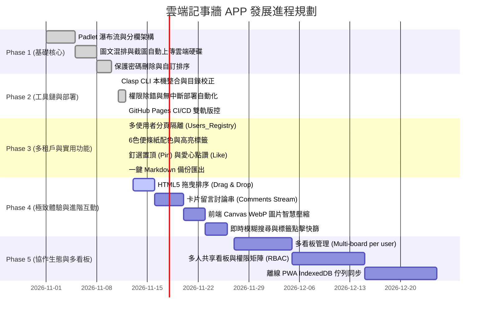

# 產品發展路線圖 (Product Roadmap)

> **專案代號**：Padlet-Style Cloud Wall App  
> **當前版本**：v2.1.0 (Phase 3 完成)  
> **規劃週期**：Phase 1 至 Phase 5

---

## 🗺️ 里程碑總覽 (Milestones Overview)

---

## 📌 各階段詳細成果與規劃說明

### 🟢 Phase 1: MVP 基礎核心架構 (已達成 100%)
- **Padlet 瀑布流欄位**：實現類似 Padlet Shelf 直式瀑布欄位，支援新增主題欄、主題重新命名。
- **圖文貼文功能**：支援標題、內文、標籤、超連結自動轉化為可點擊連結。
- **剪貼簿圖片上傳**：Ctrl+V 截圖自動讀取 Base64，非同步直傳 Google Drive 專屬照片目錄，生成 CDN 網址。
- **排序調整**：支援上移、下移、指定順序編號（`setOrderIndex`）。
- **刪除防護**：貼文時可自訂保護 PIN，刪除時需核對建立者 PIN 或後台主管理員 PIN。

### 🟢 Phase 2: 工具鏈現代化與工程自動化 (已達成 100%)
- **Google Clasp 整合**：建置 Node.js LTS + Clasp CLI，程式碼本地版控。
- **權限與目錄修正**：精準修正 Google Drive 主專案資料夾與截圖子資料夾之父子層級關係。
- **零中斷發布機制**：使用 `clasp deploy -i <deploymentId>` 覆蓋正式部署，確保 Web App 網址永不變更。
- **雙軌版控落地**：前端與文檔由 GitHub Pages 託管，後端由 Apps Script 雲端引擎執行。

### 🟢 Phase 3: 多使用者隔離與 4 大實用需求 (已達成 100%)
- **多租戶工作表隔離 (Multi-tenant)**：
  - 建立 `Users_Registry` 註冊表，登入/註冊後動態切換至專屬 `Cards_{username}` 分頁。
  - 公開訪客模式獨立於 `Padlet_Cards`，彼此資料完全互不干擾。
- **6 色便條紙色盤 (Color Palette)**：
  - 經典白、檸檬黃、薄荷綠、天際藍、櫻花粉、薰衣草紫。
- **圖釘釘選置頂 (Pin to Top)**：
  - 支援一鍵釘選 (`📌`)，釘選卡片自動提升至該主題欄位最頂端並展示特殊高亮與圖釘徽章。
- **愛心互動點讚 (Heart Likes)**：
  - 一鍵愛心計數 (`❤️`)，採用樂觀更新 (Optimistic UI) 並於後端試算表原子遞增/遞減。
- **一鍵 Markdown 備份匯出 (Export to MD)**：
  - 支援將當前看板或個人專屬看板之所有主題、卡片、標籤、時間與圖片排版匯出為標準 Markdown 檔。

### 🟡 Phase 4: 極致體驗與進階互動 (即將啟動)
- **4.1 HTML5 拖曳排序 (Drag & Drop)**：
  - 支援在同欄位內拖曳上下調整順序。
  - 支援跨主題欄位橫向拖拉卡片，自動更新欄位歸屬並重算 order。
- **4.2 卡片留言討論串 (Comments / Replies)**：
  - 每張卡片下方可展開留言列表，提供快速心得反饋。
- **4.3 前端 Canvas WebP 圖片智慧壓縮**：
  - 上傳前將大於 1MB 圖片以 HTML5 Canvas 轉成 WebP 格式，節省 70% 雲端硬碟容量與上傳耗時。
- **4.4 即時模糊搜尋與標籤篩選**：
  - 頂部搜尋列支援即時高亮關鍵字，點擊卡片標籤可一鍵過濾同標籤的所有筆記。

### ⚪ Phase 5: 協作生態與多看板 (未來規劃)
- **多看板管理**：單一帳號可自由建立多個不同看板（如：工作工作看板、個人靈感看板、讀書筆記）。
- **協作權限矩陣 (RBAC)**：支援設定「公開可讀」、「邀請編輯」、「私密僅限自己」。
- **PWA 離線同步**：斷網時寫入 IndexedDB 佇列，恢復連線後自動背景同步至 Google 試算表。
