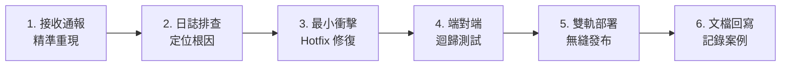

# 災難復原與維運手冊 (Recovery & Operations Runbook)

> **版本**：v2.1.0  
> **核心準則**：隨時可復原 (High Recoverability) & 零花費 (Zero Cost)  
> **適用情境**：部署失誤、雲端權限異常、資料庫誤刪、非預期錯誤或系統維護時之標準作業程序 (SOP)。

---

## 1. Google Apps Script 程式版本秒級回滾 SOP

若在某次 `clasp push` 或程式碼修改後，線上 Web App 出現嚴重錯誤，可依循以下兩種方式進行回滾：

### 1.1 方式 A：透過 Clasp 部署快照回滾
1. 列出所有雲端歷史版本部署：
   ```powershell
   clasp deployments
   ```
2. 將線上主要 Deployment ID 指向先前穩定的 Version 快照（例如 Version 5）：
   ```powershell
   clasp deploy -i "AKfycbznuGd3oq8QhzY4av8deOdNUS-f9b-r_fDqMPZl0DnXIIOEd4Ca5KlfqPZGlJmsVqM10g" -V 5 -d "Emergency Rollback to Version 5"
   ```

### 1.2 方式 B：透過 Git 歷史版本回滾並覆蓋部署
1. 本機切換回前一個正常運作的 Git Commit：
   ```powershell
   & "C:\Program Files\Git\cmd\git.exe" checkout <commit_hash> -- Code.gs
   ```
2. 強制推送並重新部署：
   ```powershell
   clasp push -f
   clasp deploy -i "AKfycbznuGd3oq8QhzY4av8deOdNUS-f9b-r_fDqMPZl0DnXIIOEd4Ca5KlfqPZGlJmsVqM10g" -d "Hotfix Rollback"
   ```

---

## 2. GitHub Pages 前端版本回滾 SOP

若前端介面（`index.html`）發生語法錯誤或白屏：
1. 查詢最新 Commit 紀錄：
   ```powershell
   & "C:\Program Files\Git\cmd\git.exe" log --oneline -n 5
   ```
2. 重設本機程式碼至穩定 Commit：
   ```powershell
   & "C:\Program Files\Git\cmd\git.exe" revert HEAD --no-edit
   & "C:\Program Files\Git\cmd\git.exe" push origin main
   ```
3. GitHub Pages 將在 60 秒內自動重新編譯並上線。

---

## 3. 資料庫試算表災難復原 SOP

### 3.1 誤刪單一筆記資料（日常軟刪除救援）
- **操作者**：總管理者
- **處置程序**：
  1. 於網頁首頁右上角點擊「⚙️ 系統管理」按鈕。
  2. 輸入目前管理密碼（預設 `8888`）。
  3. 點選「🗑️ 回收筒管理」，系統將透過 `getTrashCards` 列出所有被標記為 `is_deleted = TRUE` 之項目。
  4. 找到該筆記事，點擊「還原」，系統自動將該列 `is_deleted` 還原為 `FALSE`，記事即刻重新展示於看板。

### 3.2 使用者分頁整頁遭意外刪除（自動自我修復）
- **處置程序**：
  - 系統後端之 `resolveSheetForUser(username)` 具備**容錯防呆與自我癒合 (Self-Healing)** 機制。
  - 當使用者再次造訪或發送請求時，後端若發現該使用者工作表不存在，會自動重建該分頁並補上標準 13 欄表頭，系統不會拋出崩潰錯誤。

### 3.3 整份試算表資料被大量破壞或篡改
- **處置程序**：
  1. 開啟 Google 試算表 `雲端記事牆APP_Padlet資料庫`。
  2. 點選頂部功能表：**「檔案」 > 「版本歷程記錄」 > 「查看版本歷程記錄」**。
  3. 選擇事發前一刻的時間點快照，點選「還原這個版本」。
  4. 由於所有卡片 ID 皆為唯一時間戳，還原後無需任何程式更動即可正常運轉。

---

## 4. Google Drive 存取權限與圖片異常排查 (Troubleshooting)

### 4.1 出現「存取遭拒：DriveApp」錯誤訊息
- **根本原因**：
  - Google Apps Script 執行環境中呼叫了 `file.setSharing(...)`，而該檔案處於受限或繼承設定特殊的資料夾中。
- **標準解法**：
  - 請檢查 `Code.gs`，確保已採用 `try { file.setSharing(...) } catch(e) {}` 進行防禦性包裹。
  - 直接至 Google 雲端硬碟，對「雲端記事牆資料截圖照片」資料夾點選右鍵 > **「共用」 > 設定為「知道連結的使用者都可以檢視」**，讓所有新寫入的截圖照片自然繼承共用權限。

### 4.2 圖片無法在網頁中載入 (Broken Image)
- **排查指標**：
  - 檢視試算表 `img_url` 欄位是否為全球 CDN 直連格式：`https://lh3.googleusercontent.com/d/{fileId}`。
  - 避免使用 `drive.google.com/file/d/.../view` 或 `drive.google.com/uc?id=...`，後者受限於 Google 頻寬防盜鏈阻擋。

---

## 5. 零花費維運監控與配額保護 (Zero-Cost SLA Guard)

本專案運行於 Google Workspace 與 GitHub 免費額度內，無任何衍生費用。為避免觸發免費服務配額限制，日常維運需注意：

| 服務項目 | 免費配額上限 | 本專案安全設計與當前水位 |
| :--- | :--- | :--- |
| **GAS 單次執行時間** | 6 分鐘 / 次 | 系統單次寫入僅耗時約 0.8 ~ 1.5 秒，遠低於上限 |
| **GAS 每日觸發次數** | 20,000 次 / 日 | 充足支援日常與中小型團隊筆記速記 |
| **Google Drive 儲存容量** | 15 GB (個人免費版) | 每張壓縮截圖約 300KB ~ 600KB，可儲存超過 25,000 張圖 |
| **Google 試算表儲存上限** | 10,000,000 個儲存格 | 目前使用量約數百格，耗用率 < 0.01% |
| **GitHub Pages 流量** | 100 GB / 月 | 僅承載靜態 HTML/CSS，單月耗用通常 < 500 MB |

---

## 6. 線上維運與修 BUG (Hotfix) 標準作業程序

當系統在生產環境（GitHub Pages 或 Apps Script Web App）出現非預期異常時，必須開啟獨立的【線上維運 Session】，並嚴格遵循以下 6 步 SOP 執行修復：



### 6.1 步驟詳細說明

#### 步驟 1：問題重現與現象判定 (Reproduction & Triage)
- 判斷問題屬於 **前端呈現問題**（CSS / JS 渲染 / DOM 邏輯）或 **後端服務問題**（GAS 邏輯 / 權限 / 試算表讀寫 / Drive 存取）。
- 確認受影響的範圍：為「特定使用者分頁」還是「全域系統（包括公開牆）」。

#### 步驟 2：日誌排查與根因定位 (Log Inspection)
- **前端除錯**：開啟瀏覽器開發者工具 (F12) > `Console` 與 `Network` 分頁，檢視 `fetch` 回傳之 HTTP 狀態碼與 JSON 錯誤訊息。
- **後端除錯**：登入 Google Apps Script 專案後台，開啟側邊欄 **「執行項目 (Executions)」**，檢視失敗請求的完整錯誤堆疊 (Stack Trace)。
- **資料庫檢查**：直接開啟 Google 試算表，檢查對應欄位是否有異常格式、缺少表頭或空值錯誤。

#### 步骤 3：最小衝擊修復 (Minimal-Impact Fix)
- 嚴格遵守「最小變更原則」：僅修正問題核心點，切勿同時重構未受影響之程式碼。
- 嚴格確保五大原則：防範 XSS、密碼不落地、不破壞軟刪除機制、不調用收費 API。

#### 步驟 4：端對端迴歸測試 (End-to-End Regression Test)
- 撰寫測試情境，確認：
  1. 通報之 BUG 已被徹底修復。
  2. 現有正常功能（新增貼文、圖片貼上、自訂排序、登入/登出、點讚、釘選、Markdown 匯出）皆不受任何負面影響。

#### 步驟 5：雙軌熱修復發布 (Zero-Downtime Deployment)
- **後端程式變更**：
  ```powershell
  $env:PATH = "C:\Program Files\nodejs;C:\Users\user\AppData\Roaming\npm;$env:PATH"
  & "C:\Users\user\AppData\Roaming\npm\clasp.cmd" push -f
  & "C:\Users\user\AppData\Roaming\npm\clasp.cmd" deploy -i "AKfycbznuGd3oq8QhzY4av8deOdNUS-f9b-r_fDqMPZl0DnXIIOEd4Ca5KlfqPZGlJmsVqM10g" -d "Hotfix: 修復[問題簡述]"
  ```
- **前端程式變更**：
  ```powershell
  & "C:\Program Files\Git\cmd\git.exe" add .
  & "C:\Program Files\Git\cmd\git.exe" commit -m "fix: 修復[問題簡述]"
  & "C:\Program Files\Git\cmd\git.exe" push origin main
  ```

#### 步驟 6：事後維運記錄與文檔回寫 (Post-Mortem & Write-Back)
- 修復完成後，將該事件記錄於下方「7. 維運與 Hotfix 歷史履歷」中，包含：發生時間、現象、根因、修正方式與影響範圍。

---

## 7. 維運與 Hotfix 歷史履歷 (Maintenance Log)

| 序號 | 日期 | 類別 | 故障現象與描述 | 根本原因 (Root Cause) | 修復方案與 Commit |
| :---: | :---: | :---: | :--- | :--- | :--- |
| **01** | `2026-11-12` | 後端權限 | 新增記事發布時拋出 `存取遭拒：DriveApp` | `file.setSharing` 於特定權限目錄被阻擋 | 以 `try...catch` 包裹並改用全球 CDN 格式網址 (`2ec4829`) |
| **02** | `2026-11-12` | 環境部署 | 本機執行 clasp 指令被 PowerShell 腳本權限阻擋 | Windows PowerShell ExecutionPolicy 限制 `.ps1` | 更新 SOP 改為呼叫 `clasp.cmd` 並指定 Node 路徑 (`c66b9ef`) |
| **03** | `2026-11-12` | 前端互動 | 新使用者 (song001) 新增主題後未即時顯示、看板呈現空白 | 瀏覽器 Autofill 誤植帳號至搜尋列，且未發布卡片之新主題遭過濾與抹除 | 隔離搜尋欄位為 `type="search"` 與 `<form>` 包裹登入欄、建立主題即時清空搜尋並存入使用者隔離 LocalStorage 快取、加入平滑滾動與高亮提示動畫 |
